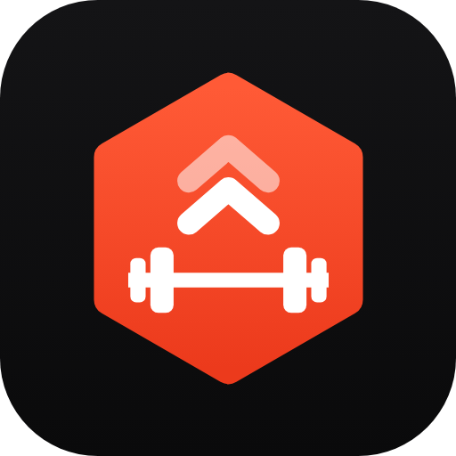
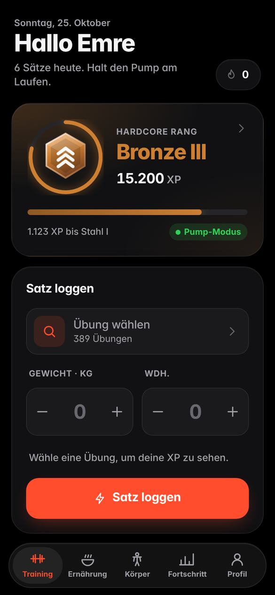
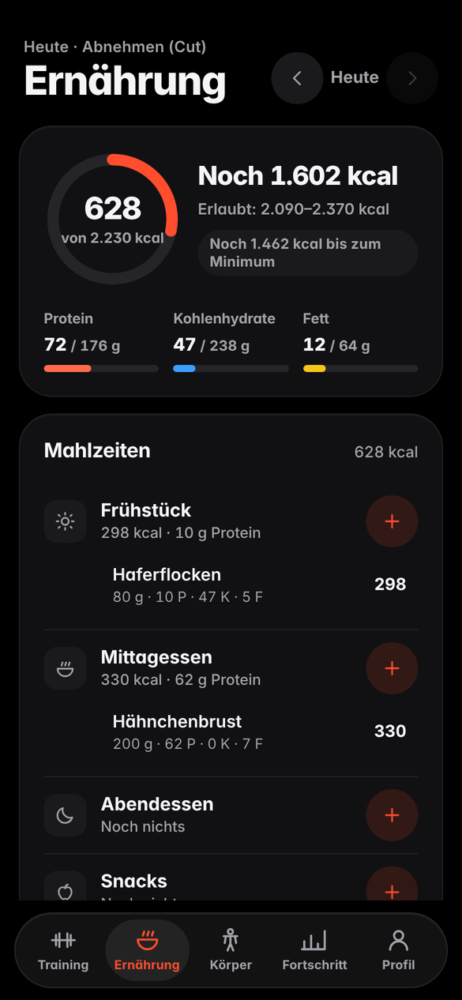
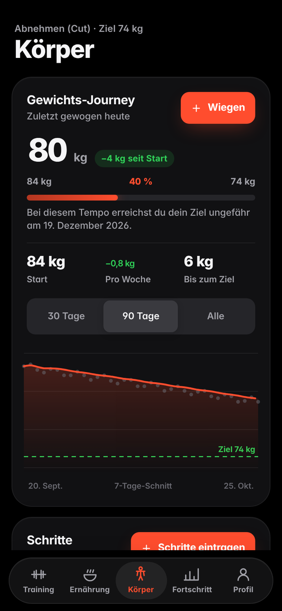
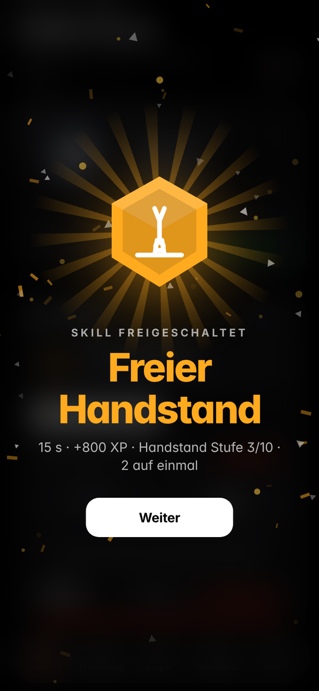
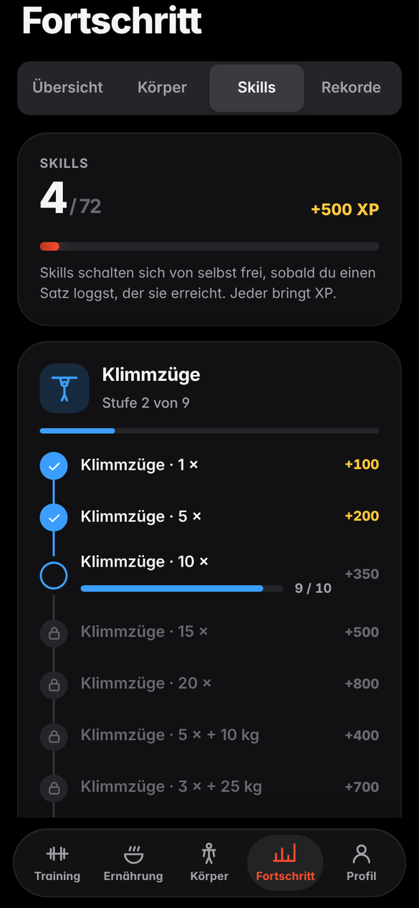
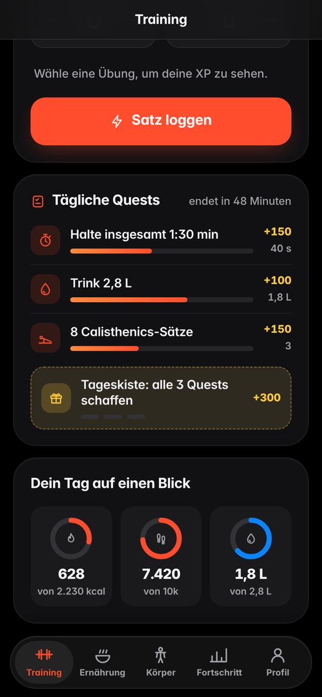

<div align="center">



# Gym Ranker

**Training, Ernährung und Körper in einem Spiel.**<br>
Jeder Satz, jeder Schritt und jede Mahlzeit bringt XP. Wer skippt, verliert.

[](https://emre1001.github.io/Gym-Ranker/)
[](https://github.com/Emre1001/Gym-Ranker/releases)
[](#-installation)
[](LICENSE)

<br>






</div>

---

## Was ist neu in v4

| | |
|:---|:---|
| 👋 **Persönliches Setup** | Beim ersten Start: Name, Alter, Größe, Gewicht, Aktivität und Ziel. Das Alter zählt mit: Alters-Bonus auf XP und Quests, die zu dir passen. Danach begrüßt dich die App mit „Hallo Emre“ und reagiert auf das, was du tust. |
| 🍽️ **Kalorientracker + Rechner** | Wie viel du essen sollst und darfst: für **Cut, Lean Bulk, Gewicht halten und Body Recomposition**, mit erlaubtem Bereich, Makros, Wasser und Lebensmittel-Datenbank. |
| 📉 **Abnehm- / Zunehm-Journey** | Gewichtskurve mit 7-Tage-Schnitt, Ziellinie, Fortschritt in %, Tempo pro Woche und Prognose, wann du dein Ziel erreichst. |
| 🚶 **Schritte mit Coach** | Tägliche Schritte eintragen, die App antwortet: von „mehr wäre besser“ bis „Wie hast du das geschafft?“. |
| 🤸 **Calisthenics** | 110+ Körpergewichts-Übungen. Wiederholungen mit **optionalem Zusatzgewicht**, Halte-Übungen **in Sekunden mit Stoppuhr** (Dead Hang, Handstand, L-Sit, Front Lever …). |
| ✨ **Skill-Bäume** | 11 Bäume, 72 Skills vom ersten Klimmzug bis zur Full Planche. Freischalten = Belohnungs-Screen mit Konfetti und Bonus-XP. |
| 🎯 **Quests & Erfolge** | 3 tägliche Quests + Tageskiste, **3 Wochen-Quests, die sich an dich anpassen**, 48 Erfolge. |
| 📱 **Handy zuerst** | 5-Tab-Navigation, Zurück-Geste schließt Fenster statt die App, Safe-Areas für Kamera-Loch und Gestenleiste, getestet von 320 px bis Desktop. |
| 🗂️ **Aufgeräumter Code** | Keine 230-KB-Einzeldatei mehr: CSS, Seiten, Daten und Sprachen liegen in eigenen Dateien. |

---

## 🏋️ Training & Rang

### 33 Ränge, von Holz bis Champion

Jeder Rang kostet **40 % mehr XP** als der vorherige. Champion III ist eine echte Lebensleistung.

<details>
<summary><b>Alle Ränge anzeigen</b></summary>

| Tier | Ränge | Schwierigkeit |
|:---|:---|:---|
| 🪵 **Holz** | I – II – III | Einstieg |
| 🥉 **Bronze** | I – II – III | Anfänger |
| ⚙️ **Stahl** | I – II – III | Regelmäßig |
| 🥈 **Silber** | I – II – III | Konsistent |
| 🥇 **Gold** | I – II – III | Fortgeschritten |
| 💎 **Diamant** | I – II – III | Ernsthaft |
| ❇️ **Emerald** | I – II – III | Dediziert |
| 🩸 **Rubin** | I – II – III | Elite |
| 🌌 **Obsidian** | I – II – III | Top 1 % |
| 🧬 **Gym Rat** | I – II – III | Lifestyle |
| 👑 **Champion** | I – II – III | Jahrelanges hartes Training |

</details>

### Faire XP für jede Übung

100 kg Beinpresse sind nicht dasselbe wie 100 kg Bankdrücken. Jede Übung hat einen Multiplikator:

```
Gewicht × Wiederholungen × Multiplikator                       = XP   (Hanteln & Maschinen)
(Körpergewicht × Anteil + Zusatzgewicht) × Wdh. × Multiplikator = XP   (Calisthenics)
(Körpergewicht × Anteil + Zusatzgewicht) × Sek. × Multiplikator = XP   (Halte-Übungen)
```

Der **Anteil** ist, wie viel deines Körpergewichts die Übung wirklich bewegt: Liegestütz ≈ 64 %, Klimmzug 100 %. Deshalb bringt ein Klimmzug mit 80 kg Körpergewicht mehr als einer mit 60 kg, und Zusatzgewicht zählt obendrauf.

### Alters-Bonus

Dasselbe Gewicht ist mit 12 oder mit 62 eine größere Leistung als mit 25. Darum gibt es auf jeden Satz einen **Alters-Bonus**, und Quests starten bei Jüngeren und Älteren mit niedrigeren Zielen:

| Alter | XP-Bonus | Quest-Startwerte |
|:---|:---:|:---:|
| bis 12 | +60 % | 50 % |
| 13 / 14 / 15 / 16 / 17 | +50 / +40 / +30 / +20 / +10 % | 55–90 % |
| 18–39 | – | 100 % |
| 40–59 | +5 bis +20 % | 80–90 % |
| 60–64 / 65+ | +30 % / +40 % | 65 % |

Ein 12-Jähriger mit 100 kg × 5 auf der Bank bekommt **800 XP** statt 500. Unter 18 bleiben Diäten beim langsamen Tempo und die App erinnert an „Technik vor Gewicht“.

### XP bluten

Nach **3 Tagen Pause** verlierst du **2 % deiner XP pro Tag**. Bleibst du zu lange weg, steigst du ab. Das System belohnt Konstanz, nicht Einzelleistungen.

### Werkzeuge

Pausentimer (läuft auch nach Neustart weiter), Scheibenrechner, 1RM-Rechner, Stärke-Map mit Rang pro Muskel, Rekorde, Verlauf, eigene Übungen, Favoriten.

---

## 🤸 Calisthenics & Skills



- **Wiederholungen:** Zusatzgewicht eintragen oder leer lassen (= nur Körpergewicht).
- **Halten:** Sekunden eintippen oder die eingebaute **Stoppuhr** nutzen.
- **11 Skill-Bäume:** Klimmzüge, Liegestütze, Dips, Muscle-Up, Handstand, Front Lever, Planche, Bauch & L-Sit, Beine, Flag & Lever, Griffkraft.
- Skills schalten sich **von selbst frei**, sobald ein geloggter Satz sie erreicht, z. B. *10 Klimmzüge*, *Freier Handstand 30 s*, *Klimmzug + 25 kg × 3*.
- Jeder Skill bringt **100 bis 3.000 XP** und einen eigenen Belohnungs-Screen.
- Der Logger zeigt live, welcher Skill als Nächstes kommt.

<br clear="right">

---

## 🍽️ Ernährung & Kalorienrechner

Der Rechner nutzt die **Mifflin-St-Jeor-Formel** mit deinem Aktivitätslevel und zeigt alle Ziele nebeneinander:

| Ziel | Kalorien | Protein | Was passiert |
|:---|:---|:---|:---|
| **Abnehmen (Cut)** | Erhaltung −10 / −20 / −25 % (langsam / normal / schnell) | 2,2 g/kg | Fett runter, Muskeln bleiben |
| **Lean Bulk** | Erhaltung +5 / +10 / +15 % | 1,8 g/kg | Muskeln rauf, wenig Fett |
| **Gewicht halten** | Erhaltung ± 5 % | 1,8 g/kg | Stärker werden ohne Diät |
| **Body Recomposition** | Trainingstage +5 %, Ruhetage −15 % | 2,2 g/kg | Gleichzeitig Fett verlieren und Muskeln aufbauen |

- Zu jedem Ziel: **Zielwert und erlaubter Bereich** („Erlaubt: 2.090–2.370 kcal“) plus erwartete Veränderung pro Woche.
- Ein Minimum (1.500 kcal für Männer, 1.200 kcal für Frauen) wird nie unterschritten.
- **Mahlzeiten:** Frühstück, Mittag, Abend, Snacks. Über 70 Lebensmittel (auch Döner, Lahmacun, Simit, Ayran …) mit Grammzahl, oder eigene Werte schnell eintragen.
- **Wasser** mit Ziel nach Körpergewicht (35 ml/kg), 7-Tage-Verlauf, Tipps passend zu deinem Ziel.

---

## 📉 Körper

- **Gewichts-Journey:** Kurve mit 7-Tage-Schnitt, Ziellinie, Start → Ziel in %, kg pro Woche, Prognosedatum.
- **Schritte:** eintragen, Wochenbalken mit Ziellinie, ca. verbrannte kcal, und ein Coach, der antwortet.
- **Körpermaße:** Taille, Brust, Arm, Hüfte, Oberschenkel, Hals mit Veränderung zur letzten Messung, BMI und Körperfett-Schätzung (US-Navy-Formel).
- **Tipps zum Abnehmen und Zunehmen**, passend zu deinem Ziel.

---

## 🎯 Quests & Erfolge



**Tägliche Quests** (3 pro Tag): z. B. *15 Sätze loggen*, *Beine: 4 Sätze*, *8.000 Schritte*, *Protein-Ziel schaffen*, *In deinem Kalorienbereich landen*. Alle drei geschafft → **Tageskiste mit +300 XP**.

**Wochen-Quests** (3 pro Woche) passen sich an dich an: Ziel = dein Schnitt der letzten 4 aktiven Wochen **plus 20–30 %**, nie unter einem realistischen Startwert, der sich nach deinem Alter richtet. Wer sonst 800 Liegestütze pro Woche schafft, bekommt *1.000 Liegestütze diese Woche*. Die Ziele werden montags festgelegt und ändern sich während der Woche nicht.

**48 Erfolge**, von *Erste Wiederholung* über *Unzerbrechlich (30 Tage Streak)* bis *Skill-Meister*.

<br clear="right">

---

## 📲 Installation

### 🤖 Android (.apk)

1. Öffne den **[Releases-Tab](https://github.com/Emre1001/Gym-Ranker/releases)**
2. Lade die neueste `.apk` herunter und installiere sie
3. Falls nötig: „Installation aus unbekannten Quellen“ erlauben

### 🍏 iPhone & 🌐 Web (PWA)

| Schritt | Aktion |
|:---:|:---|
| **1** | **[emre1001.github.io/Gym-Ranker](https://emre1001.github.io/Gym-Ranker/)** in Safari bzw. Chrome öffnen |
| **2** | iPhone: *Teilen* → *Zum Home-Bildschirm* · Android: Menü ⋮ → *App installieren* |
| **3** | Fertig: Vollbild, offline, ohne Account |

---

## 🔒 Deine Daten

Alles bleibt **auf deinem Gerät** (localStorage). Kein Account, keine Cloud, kein Tracking.
Unter *Profil → Einstellungen → Daten* kannst du ein Backup als Code oder Datei sichern, wiederherstellen und alle Sätze als CSV exportieren. Alte Spielstände und Backup-Codes funktionieren weiter.

**Sprachen:** Deutsch, English, Türkçe · **Design:** Hell / Dunkel / Automatisch · **Einheiten:** kg / lbs

---

## 🛠️ Entwicklung

Reines HTML, CSS und JavaScript, ohne Build-Schritt und ohne Abhängigkeiten.

```bash
git clone https://github.com/Emre1001/Gym-Ranker.git
cd Gym-Ranker
python3 -m http.server 8000      # dann http://localhost:8000 öffnen
```

<details>
<summary><b>Projektstruktur</b></summary>

```
index.html              Gerüst: Seiten, Tab-Leiste, Icons
css/app.css             Design-System (Farben, Karten, Buttons, Sheets)
css/features.css        App-Hülle, Quests, Ernährung, Körper, Profil, Skills, Setup
js/core.js              Hilfsfunktionen, Einstellungen, Ränge, XP, Rekorde
js/ui.js                Toasts, Bottom-Sheets, Segment-Schalter
js/health.js            Profil, Kalorienrechner, Gewicht, Schritte, Wasser, Essen, Maße
js/game.js              Quests, Wochen-Quests, Erfolge, Skills, Belohnungs-Screens
js/onboarding.js        Einrichtung beim ersten Start
js/back-stack.js        Zurück-Geste: schließt Fenster und Unterseiten zuerst
js/tools.js             Pausentimer, Scheiben- und 1RM-Rechner, Rang-Aufstieg
js/app.js               Navigation und Start
js/pages/*.js           Training, Ernährung, Körper, Fortschritt, Profil, Übungen, Verlauf, Einstellungen
js/data/*.js            Übungen, Calisthenics, Skill-Bäume, Lebensmittel, Tipps
js/i18n/{de,en,tr}.js   Alle Texte
sw.js                   Offline-Cache
```

</details>

---

## 🗺️ Roadmap

- [x] 33-Rang-System mit Decay
- [x] 300+ Gym-Übungen mit Multiplikatoren
- [x] Kalorienrechner für Cut / Lean Bulk / Halten / Recomp
- [x] Gewichts-Journey, Schritte, Körpermaße
- [x] Calisthenics mit Zusatzgewicht und Halte-Übungen
- [x] Skill-Bäume mit Belohnungen
- [x] Tägliche und anpassende Wochen-Quests, Erfolge
- [x] Alters-Bonus und altersgerechte Quests
- [x] Deutsch / English / Türkçe
- [ ] Freundes-Rangliste
- [ ] Schritte automatisch vom Handy übernehmen

---

## 🤝 Mitmachen

Pull Requests sind willkommen, besonders neue Übungen, Lebensmittel, Skills und Übersetzungen.

<div align="center">

*Stay consistent. Don't skip leg day.*

**Become a Champion. 👑**

</div>
